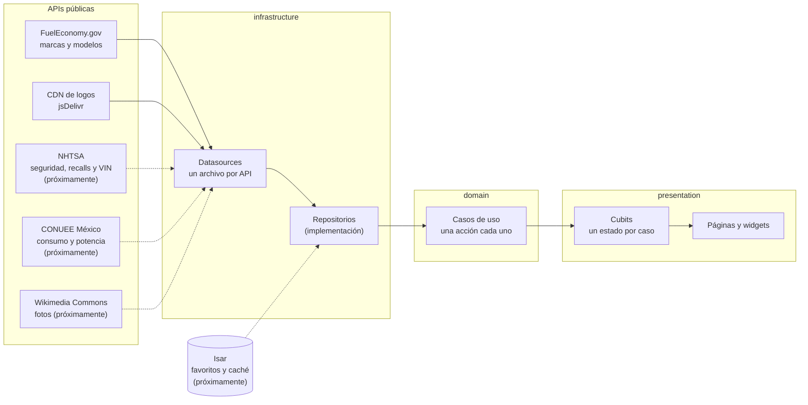

# Cars Wheels

App Flutter de catálogo de autos con datos en tiempo real de APIs públicas: marcas, modelos y, próximamente, consumo, seguridad, recalls y fotos.

> Estado: en desarrollo (Sprint 1).

## Cómo fluye la información



Las líneas punteadas son partes que aún no están construidas. `domain` define las interfaces de los repositorios e `infrastructure` las implementa.

## Arquitectura

Arquitectura limpia con DDD ligero, organizada por features y capas (`domain`, `infrastructure`, `presentation`). Estado con BLoC/Cubit. Un archivo barril por carpeta, con el mismo nombre de su carpeta.

## Tecnologías

Flutter, `flutter_bloc`, `dio`, `go_router`, `isar_community`, `animate_do`, `animations`, `google_fonts` y `material_symbols_icons`.

## Fuentes de datos y créditos

- FuelEconomy.gov (EPA y DOE): marcas, modelos y consumo.
- Logos de marcas: colección `vehiclespecs/brand-logos`. Son marcas registradas de sus dueños.
- NHTSA y CONUEE (datos.gob.mx, licencia CC BY 4.0): próximamente.
- Wikimedia Commons: próximamente, cada foto con su autor y licencia.

## Cómo correrla

```
flutter pub get
flutter run
flutter test
```

## Autor

Desarrollado por el Ing. Ernesto Alfonso Sánchez Montiel.
